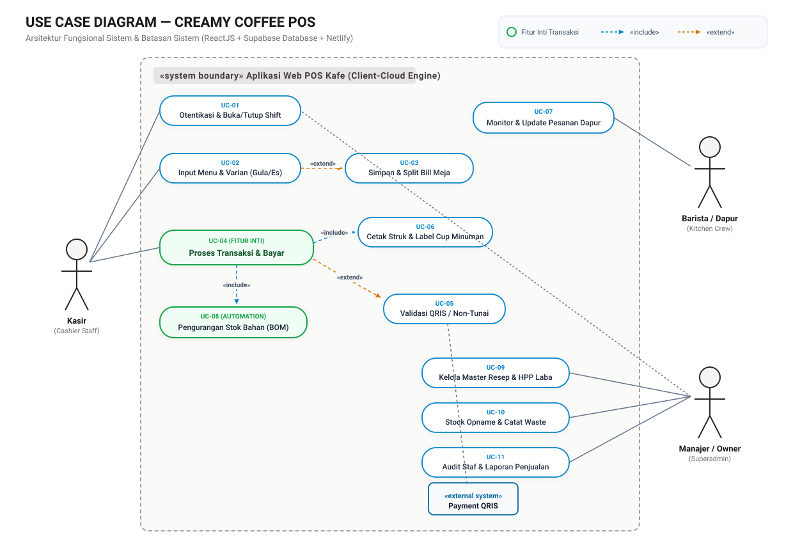
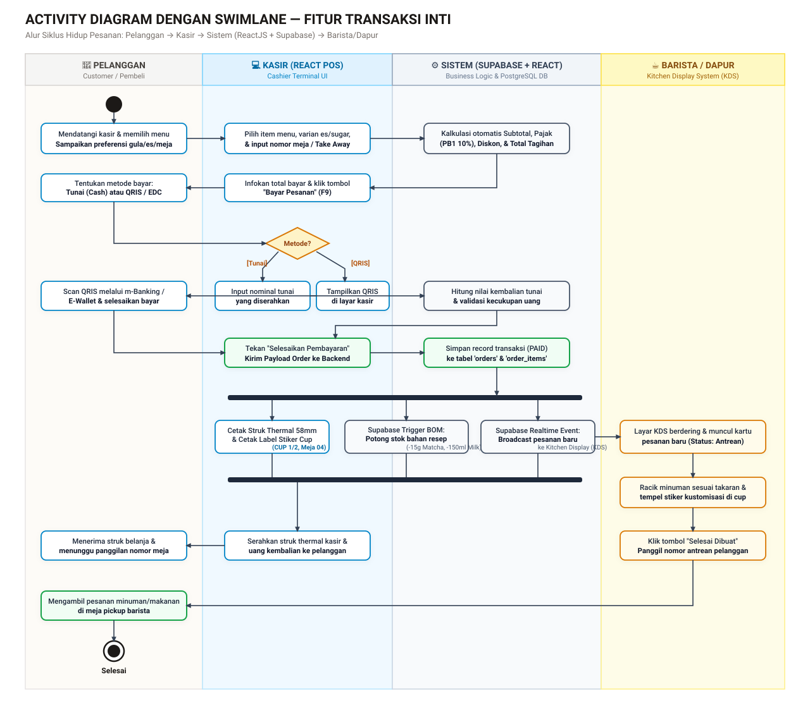

# CREAMY COFFEE POS — Sistem Kasir & Manajemen Operasional Kafe
> **Tugas Proyek Kelompok Rekayasa Perangkat Lunak / Sistem Informasi (Pertemuan 6)**  
> **Tech Stack:** ReactJS + Supabase (PostgreSQL) + Netlify + GitHub  
> **Repositori:** [github.com/iphamahmaddeveloper-jpg/creamy-coffee-pos](https://github.com/iphamahmaddeveloper-jpg/creamy-coffee-pos)

[](https://app.netlify.com/start/deploy?repository=https://github.com/iphamahmaddeveloper-jpg/creamy-coffee-pos)

---

## 📌 Ringkasan Proyek

Aplikasi **CREAMY COFFEE POS** adalah sistem kasir Point of Sale berbasis web modern yang dirancang khusus untuk operasional kafe, coffee shop, dan restoran. Antarmuka didesain secara fungsional, bersih, dan ergonomis mengikuti standar industri kasir F&B nyata (seperti Moka POS, Square, dan Toast) tanpa gaya template AI yang artifisial.

### Modul Fungsional Utama:
1. **Kasir Penjualan Cepat (POS Terminal):** Katalog menu kategori, variasi takaran gula (*Normal/Less/No Sugar*), level es (*Normal/Less/Hot*), pemilihan meja (*Meja 01–08* & *Take Away*), fitur **Simpan Draft Bill**, **Split Bill**, dan multi-pembayaran (**Tunai, QRIS Dinamis, Kartu Debit**).
2. **Resep Bahan Baku (Bill of Materials / BOM):** Setiap menu terhubung dengan komposisi bahan mentah (gram/ml/pcs). Stok bahan otomatis terpotong saat transaksi berstatus `PAID`.
3. **Kalkulasi HPP & Margin Laba:** Menghitung Harga Pokok Penjualan (HPP) secara otomatis berdasarkan harga beli bahan baku serta menampilkan estimasi sisa porsi yang dapat dibuat.
4. **Kitchen Display System (KDS):** Layar antrean pesanan untuk Barista dapur yang tersinkronisasi secara *real-time*.
5. **Cetak Struk Thermal & Label Cup:** Pratinjau struk thermal 58mm/80mm lengkap dengan info Wi-Fi kafe serta stiker label cup gelas (`CUP 1/2`).
6. **Audit Anti-Fraud & Rekonsiliasi Shift:** Manajemen buka/tutup shift kasir dengan *blind cash count* untuk mendeteksi selisih kas (*cash variance*).

---

## 📊 Artefak Visual Perancangan Sistem (Pertemuan 6)

Laporan lengkap naratif perancangan dapat diakses di:  
📄 **[Dokumen Laporan Perancangan POS (docs/LAPORAN_PERANCANGAN_POS.md)](./docs/LAPORAN_PERANCANGAN_POS.md)**

### 1. Use Case Diagram (Batasan Sistem & Aktor)
Menampilkan 4 aktor (*Kasir, Barista/Dapur, Manajer/Owner, dan Sistem QRIS*) beserta relasi `«include»` dan `«extend»`.



### 2. Activity Diagram dengan Swimlane (Fitur Transaksi Inti)
Memetakan 4 swimlane lintas peran (*Pelanggan, Kasir, Sistem ReactJS + Supabase, dan Barista*) dari inisiasi pesanan hingga serah terima produk.



---

## 📋 Spesifikasi 3 Use Case Utama

| ID | Nama Use Case | Aktor Utama | Deskripsi Singkat |
| :--- | :--- | :--- | :--- |
| **UC-04** | **Proses Transaksi & Pembayaran** | Kasir | Menghitung tagihan, menerima uang tunai / scan QRIS, simpan data ke Supabase, cetak struk kasir & stiker cup, serta kirim tiket ke dapur. |
| **UC-08** | **Pengurangan Stok Resep (BOM)** | Sistem (Supabase Trigger) | Mengurangi stok bahan mentah di database secara otomatis berdasarkan resep menu begitu pesanan berstatus `PAID`. |
| **UC-11** | **Rekonsiliasi Shift & Tutup Laci Kas** | Kasir & Manajer | Menghitung fisik kas di laci kasir (*blind count*), mendeteksi selisih kas (*variance*), dan mencetak laporan serah terima shift. |

---

## 🛠️ Arsitektur Teknologi & Database

- **Frontend:** React 19, Tailwind CSS, Lucide Icons, Vite
- **Backend & Database:** Supabase Cloud (PostgreSQL relasional, Database Triggers, Realtime WebSocket)
- **File Skema Database Supabase:** [`supabase/schema.sql`](./supabase/schema.sql)
- **Deployment:** Netlify (dengan konfigurasi SPA fallback di [`netlify.toml`](./netlify.toml))
- **Version Control:** GitHub

---

## 🚀 Panduan Menjalankan Secara Lokal

```bash
# 1. Clone repositori
git clone https://github.com/iphamahmaddeveloper-jpg/creamy-coffee-pos.git
cd creamy-coffee-pos

# 2. Install dependensi
npm install

# 3. Jalankan aplikasi web
npm run client
# atau jalankan mode lengkap bersama server mock
npm run dev
```

Buka peramban di: `http://localhost:5175`

### Akun Uji Coba (Login Staf):
- **Kasir:** Username `nadia` | PIN `1234`
- **Barista:** Username `rizky` | PIN `5678`
- **Owner / Superadmin:** Username `owner` | PIN `9999`
