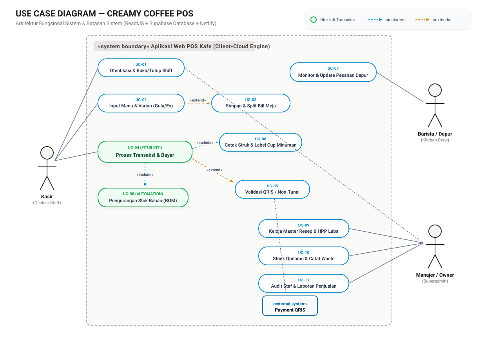
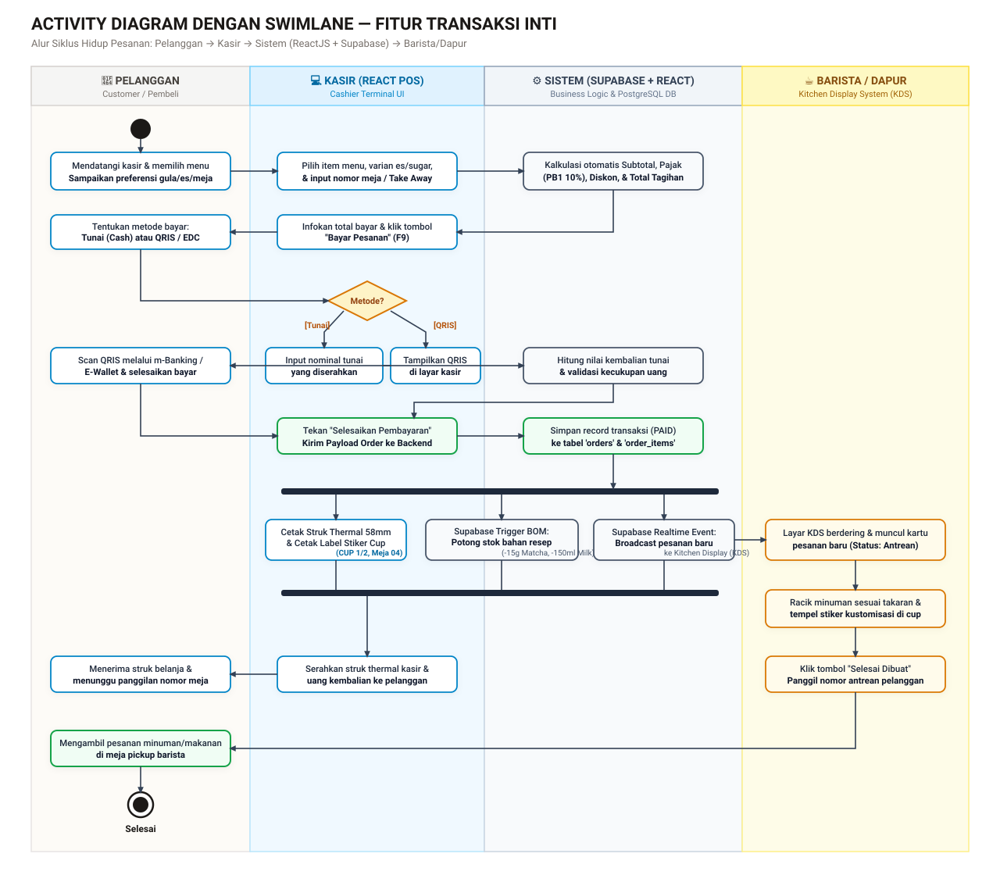

# LAPORAN TUGAS PROYEK REKAYASA PERANGKAT LUNAK
## Perancangan Sistem Point of Sale (POS) & Manajemen Operasional Kafe
### "CREAMY COFFEE POS"

---

**Mata Kuliah:** Analisis & Perancangan Sistem Informasi / Rekayasa Perangkat Lunak  
**Pekan Tugas:** Pekan Ini (Pertemuan 6)  
**Tech Stack:**
- **Frontend:** ReactJS 19 + Tailwind CSS + Lucide Icons + Vite
- **Backend & Database:** Supabase (PostgreSQL, Realtime Subscriptions, Database Triggers)
- **Deployment Platform:** Netlify (Continuous Deployment)
- **Version Control:** GitHub

---

## DAFTAR ISI
1. [BAB I: Profil Proyek & Arsitektur Solusi](#bab-i-profil-proyek--arsitektur-solusi)
2. [BAB II: Use Case Diagram & Batasan Sistem](#bab-ii-use-case-diagram--batasan-sistem)
3. [BAB III: Spesifikasi Deskriptif (3 Skenario Naratif Use Case Utama)](#bab-iii-spesifikasi-deskriptif-3-skenario-naratif-use-case-utama)
   - [3.1 UC-04: Memproses Transaksi Penjualan dan Pembayaran](#31-uc-04-memproses-transaksi-penjualan-dan-pembayaran)
   - [3.2 UC-08: Pengurangan Stok Otomatis Berbasis Resep (Bill of Materials)](#32-uc-08-pengurangan-stok-otomatis-berbasis-resep-bill-of-materials)
   - [3.3 UC-11: Rekonsiliasi Shift Kasir & Tutup Laci Kas](#33-uc-11-rekonsiliasi-shift-kasir--tutup-laci-kas)
4. [BAB IV: Activity Diagram dengan Swimlane (Fitur Transaksi Inti)](#bab-iv-activity-diagram-dengan-swimlane-fitur-transaksi-inti)
5. [BAB V: Arsitektur Supabase & Konfigurasi Deployment Netlify](#bab-v-arsitektur-supabase--konfigurasi-deployment-netlify)
6. [BAB VI: Panduan Akses Artefak Visual & Repositori](#bab-vi-panduan-akses-artefak-visual--repositori)

---

## BAB I: Profil Proyek & Arsitektur Solusi

Aplikasi **CREAMY COFFEE POS** dirancang untuk menjawab permasalahan operasional kafe modern, khususnya:
1. Kecepatan pencatatan kasir dengan antarmuka yang intuitif dan manusiawi (bukan desain generic template AI), memudahkan input varian gula (*Normal/Less/No*), es (*Normal/Less/Hot*), nomor meja, hingga split bill per orang.
2. Sinkronisasi dapur otomatis (*Kitchen Display System*) tanpa kertas tiket tercecer.
3. Otomatisasi pengurangan inventori bahan baku berbasis resep porsi (*Bill of Materials* / BOM), kalkulasi HPP (*Harga Pokok Penjualan*), dan margin laba kotor.
4. Pencegahan kecurangan kasir (*Anti-Fraud & Audit Trail*) dengan fitur buka/tutup shift laci kas (*blind cash count*) dan pencatatan selisih kas (*cash variance*).

```
[ Frontend: ReactJS (Netlify) ] 
       │
       ▼ (HTTPS / Supabase Client SDK)
[ Supabase Cloud (PostgreSQL + Realtime WebSocket) ]
       ├── Tables: orders, order_items, ingredients, recipes, shifts
       ├── Triggers: Auto Deduct Stock on Order Status = 'PAID'
       └── Realtime Channel: Broadcast ticket to Kitchen Display System (KDS)
```

---

## BAB II: Use Case Diagram & Batasan Sistem

Diagram Use Case memetakan batasan sistem (*system boundary*) aplikasi POS kafe serta relasi interaksi fungsional antara seluruh aktor.

### 2.1 Artefak Visual Use Case Diagram


> *File visual vector beresolusi tinggi tersedia di: `docs/use-case-diagram.svg`*

### 2.2 Batasan Sistem (System Boundary)
Batasan sistem mencakup seluruh modul aplikasi kasir berbasis web:
- Modul Otentikasi & Sesi Shift Kasir
- Modul Katalog Menu & Kustomisasi Pesanan
- Modul Transaksi Pembayaran (Tunai, QRIS Dinamis, Kartu Debit)
- Modul Cetak Struk Kasir Thermal (58mm/80mm) & Stiker Label Cup Minuman
- Modul Layar Antrean Dapur (*Kitchen Display System*)
- Modul Manajemen Resep, Bahan Mentah, HPP, & Stock Opname
- Modul Rekonsiliasi Kas & Audit Trail Aktivitas Staf

### 2.3 Identifikasi Aktor
1. **Kasir (*Cashier Staff*):** Aktor primer yang bertugas di garda depan untuk mengoperasikan kasir, menginput pesanan pelanggan, menerima pembayaran, membuka dan menutup shift, serta mencetak struk.
2. **Barista / Dapur (*Kitchen Crew*):** Aktor yang memantau layar antrean dapur secara *real-time*, meracik pesanan sesuai kustomisasi es/gula, dan memperbarui status pesanan menjadi selesai.
3. **Manajer / Owner (*Superadmin*):** Aktor manajerial yang mengelola master resep (*Bill of Materials*), menentukan harga jual, memantau pergerakan stok bahan, melihat riwayat audit kecurangan kasir, dan memeriksa rekonsiliasi kas harian.
4. **Sistem Payment Gateway QRIS (*External System*):** Sistem eksternal yang menyediakan QRIS dinamis dan memvalidasi penyelesaian transaksi nontunai.

---

## BAB III: Spesifikasi Deskriptif (3 Skenario Naratif Use Case Utama)

Berikut adalah spesifikasi naratif terstruktur sesuai kaidah rekayasa perangkat lunak untuk 3 use case utama:

### 3.1 UC-04: Memproses Transaksi Penjualan dan Pembayaran

| Komponen | Spesifikasi Rinci |
| :--- | :--- |
| **Use Case ID** | **UC-04** |
| **Nama Use Case** | Memproses Transaksi Penjualan dan Pembayaran (*Process Sale & Payment*) |
| **Aktor Utama** | Kasir |
| **Aktor Pendukung** | Pelanggan, Barista/Dapur, Payment Gateway QRIS |
| **Deskripsi Singkat** | Kasir memproses transaksi pesanan yang telah dikonfigurasi di keranjang belanja, memilih metode bayar (Tunai atau QRIS), memvalidasi pembayaran, mencetak struk kasir, memotong stok bahan secara otomatis, dan meneruskan tiket ke dapur. |
| **Pre-condition** | Sesi shift kasir telah dibuka (*status: OPEN*), dan terdapat minimal satu item pesanan aktif di keranjang belanja kasir. |
| **Post-condition** | Status pesanan tercatat `PAID` di database Supabase, stok bahan mentah otomatis berkurang, struk belanja tercetak, dan antrean muncul di layar KDS Barista. |

#### Skenario Utama (Main Flow):
1. Kasir memeriksa daftar item pesanan pada panel kasir ReactJS (menu, varian es/gula, nomor meja/take away).
2. Kasir menekan tombol shortcut **"Bayar" / F9**.
3. Sistem menampilkan modal pembayaran dengan rincian total tagihan, diskon, dan pajak PB1 10%.
4. Kasir menanyakan metode bayar ke pelanggan, dan pelanggan memilih **Tunai (Cash)**.
5. Kasir memilih tab metode Tunai dan menginput nominal uang yang diserahkan pelanggan (atau menggunakan tombol cepat: Uang Pas, 50k, 100k).
6. Sistem secara otomatis menghitung nilai uang kembalian (*change*).
7. Kasir menekan tombol konfirmasi **"Selesaikan Pembayaran"**.
8. Frontend ReactJS mengirim payload transaksi ke Supabase (tabel `orders` dan `order_items`).
9. Supabase Database Trigger memotong stok bahan baku pada tabel `ingredients` sesuai formula resep produk.
10. Sistem menampilkan pratinjau cetak struk kasir (thermal 58mm) dan label stiker cup (`CUP 1/2`), serta memicu dialog cetak printer.
11. Supabase Realtime memancarkan event ke modul *Kitchen Display System* barista.
12. Kasir menyerahkan struk beserta uang kembalian kepada pelanggan.

#### Skenario Alternatif & Pengecualian (Alternative / Exception Flow):
- **4a. Pelanggan memilih metode pembayaran QRIS Dinamis:**
  - 4a.1. Kasir memilih opsi "QRIS Dinamis".
  - 4a.2. Sistem membangkitkan kode QRIS pada layar kasir dengan nominal tagihan yang terkunci.
  - 4a.3. Pelanggan melakukan pemindaian (*scan*) menggunakan aplikasi m-Banking atau dompet digital (GoPay/OVO/ShopeePay/Dana).
  - 4a.4. Setelah notifikasi pembayaran berhasil diterima, sistem otomatis menandai transaksi lunas dan melanjutkan ke langkah 8.
- **5a. Uang tunai yang diinput kurang dari total belanja:**
  - 5a.1. Sistem menampilkan peringatan *"Nominal uang tunai belum mencukupi"*.
  - 5a.2. Tombol konfirmasi bayar tetap dinonaktifkan (*disabled*) hingga nominal yang dimasukkan $\ge$ total tagihan.
- **9a. Bahan baku tidak mencukupi (Stok Defisit):**
  - 9a.1. Database mendeteksi stok bahan baku tidak mencukupi dan mengembalikan respon peringatan.
  - 9a.2. Sistem membatalkan transaksi dan memberikan notifikasi pop-up kepada kasir mengenai bahan yang habis agar kasir dapat mengonfirmasi alternatif ke pelanggan.

---

### 3.2 UC-08: Pengurangan Stok Otomatis Berbasis Resep (Bill of Materials)

| Komponen | Spesifikasi Rinci |
| :--- | :--- |
| **Use Case ID** | **UC-08** |
| **Nama Use Case** | Pengurangan Stok Otomatis Berbasis Resep (*Recipe-Based Auto Stock Deduction*) |
| **Aktor Utama** | Sistem (Supabase Database Trigger & Business Logic Engine) |
| **Aktor Pendukung** | Manajer / Owner |
| **Deskripsi Singkat** | Sistem secara otomatis menguraikan menu yang terjual menjadi bahan-bahan mentah penyusunnya sesuai takaran resep (*Bill of Materials*), mengurangi stok gudang/bar, dan mencatat riwayat mutasi stok (*audit log*). |
| **Pre-condition** | Menu yang dijual memiliki master data resep di tabel `recipes`, dan sebuah transaksi penjualan berhasil berstatus `PAID`. |
| **Post-condition** | Nilai saldo stok bahan baku pada tabel `ingredients` berkurang secara presisi, log mutasi tercatat, dan notifikasi peringatan muncul bila stok menipis. |

#### Skenario Utama (Main Flow):
1. Sistem menangkap event transaksi penjualan yang sukses dibayar (`status = PAID`).
2. Sistem mengiterasi seluruh item menu yang dibeli beserta kuantitasnya dari `order_items`.
3. Untuk setiap item menu (misal: 1 porsi *Matcha Latte*), sistem mengambil data komposisi resep dari database:
   - 15 gram Bubuk Matcha Uji
   - 150 ml Susu Fresh Milk
   - 20 ml Simple Syrup
   - 1 pcs Cup Paper 16oz
4. Sistem mengalikan setiap takaran bahan dengan kuantitas yang dipesan.
5. Sistem mengeksekusi kalkulasi pengurangan:  
   $$\text{Stok Baru} = \text{Stok Saat Ini} - (\text{Takaran Resep} \times \text{Jumlah Pesanan})$$
6. Sistem memperbarui nilai stok pada tabel `ingredients`.
7. Sistem mencatat riwayat pemotongan bahan ke tabel `stock_audit_trail` dengan nomor referensi ID Transaksi.
8. Sistem memeriksa apakah stok akhir berada di bawah ambang batas minimum (*reorder point*). Jika masih aman, alur selesai.

#### Skenario Alternatif & Pengecualian (Alternative / Exception Flow):
- **8a. Saldo stok bahan menyentuh batas kritis (*Low Stock Warning*):**
  - 8a.1. Sistem menandai status bahan baku menjadi `is_low_stock = true`.
  - 8a.2. Sistem mengirimkan sinyal notifikasi *warning* berwarna merah/kuning pada dashboard Manajer Toko.
  - 8a.3. Manajer menerima sinyal peringatan untuk segera melakukan belanja restock atau mematikan ketersediaan menu di kasir.

---

### 3.3 UC-11: Rekonsiliasi Shift Kasir & Tutup Laci Kas

| Komponen | Spesifikasi Rinci |
| :--- | :--- |
| **Use Case ID** | **UC-11** |
| **Nama Use Case** | Rekonsiliasi Shift Kasir & Tutup Laci Kas (*Cash Shift Reconciliation & Closing*) |
| **Aktor Utama** | Kasir |
| **Aktor Pendukung** | Manajer / Owner |
| **Deskripsi Singkat** | Kasir melakukan penghitungan uang fisik aktual di laci kasir pada akhir jam kerja tanpa mengetahui ekspektasi sistem (*blind count*), membandingkannya dengan catatan sistem, dan merekam selisih kas (*variance*). |
| **Pre-condition** | Sesi shift kerja kasir sedang aktif (*status: OPEN*), dan tidak ada transaksi yang menggantung (*pending*). |
| **Post-condition** | Status shift berubah menjadi `CLOSED`, selisih kas tercatat di database, dan lembar laporan serah terima shift tercetak. |

#### Skenario Utama (Main Flow):
1. Kasir membuka menu **"Tutup Shift / Rekonsiliasi Kas"** pada panel kasir.
2. Kasir membuka laci kas (*cash drawer*) dan menghitung seluruh uang tunai fisik yang ada.
3. Kasir memasukkan total uang fisik aktual ke kolom isian sistem.
4. Kasir mengisi catatan pengeluaran kas kecil operasional (jika ada uang keluar untuk keperluan darurat kafe).
5. Kasir menekan tombol **"Verifikasi & Tutup Shift"**.
6. Sistem menghitung saldo kas yang seharusnya ada (*Expected Cash*):  
   $$\text{Saldo Kas Sistem} = \text{Kas Awal (Modal)} + \text{Total Penjualan Tunai} - \text{Kas Keluar}$$
7. Sistem membandingkan uang fisik aktual dengan ekspektasi sistem:  
   $$\text{Selisih Kas (Variance)} = \text{Uang Fisik Aktual} - \text{Saldo Kas Sistem}$$
8. Nilai selisih tepat Rp 0 (uang pas), sistem mengunci sesi shift dan mengubah status menjadi `CLOSED`.
9. Sistem mencetak struk laporan shift (*Shift Report*) berisi ringkasan penjualan tunai, QRIS, jumlah transaksi, dan jam tutup.
10. Kasir menyerahkan laci kas dan struk laporan kepada manajer atau kasir shift selanjutnya.

#### Skenario Alternatif & Pengecualian (Alternative / Exception Flow):
- **8a. Terjadi selisih kas (Uang Fisik Lebih atau Uang Fisik Kurang/Tekor):**
  - 8a.1. Sistem menampilkan dialog peringatan selisih kas berwarna oranye/merah.
  - 8a.2. Sistem mewajibkan kasir untuk mengisi kolom **Alasan / Catatan Selisih Kas** (misal: "Kembalian receh 500 rupiah dibulatkan").
  - 8a.3. Sistem menandai shift tersebut dengan status `variance_flag = true` dan merekam catatan audit kasir ke tabel `audit_logs` untuk diinvestigasi oleh Manajer / Owner.

---

## BAB IV: Activity Diagram dengan Swimlane (Fitur Transaksi Inti)

Activity Diagram memodelkan alur kerja (*workflow*) sekuensial dan paralel dari transaksi penjualan inti, membagi tanggung jawab ke dalam 4 jalur swimlane: **Pelanggan**, **Kasir**, **Sistem (ReactJS + Supabase)**, dan **Barista / Dapur**.

### 4.1 Artefak Visual Activity Diagram Swimlane


> *File visual vector beresolusi tinggi tersedia di: `docs/activity-diagram-swimlane.svg`*

### 4.2 Analisis Alur Kerja Lintas Entitas

1. **Inisiasi & Konfigurasi Menu:**
   - Pelanggan memilih menu dan menyebutkan preferensi gula (*Normal/Less/No*), es (*Normal/Less/Hot*), serta nomor meja / take away.
   - Kasir menginput preferensi tersebut ke keranjang kasir ReactJS.
   - Sistem secara reaktif mengkalkulasi subtotal, pajak PB1 10%, dan diskon.

2. **Percabangan Pembayaran (*Decision Node*):**
   - **Jalur Tunai:** Kasir menginput nominal uang yang diserahkan pelanggan $\rightarrow$ Sistem menghitung kembalian $\rightarrow$ Kasir mengonfirmasi bayar.
   - **Jalur QRIS:** Sistem menampilkan QRIS $\rightarrow$ Pelanggan melakukan pemindaian $\rightarrow$ Sistem memvalidasi status lunas.

3. **Sinkronisasi Paralel (*Fork Bar*):**
   Setelah status transaksi dikonfirmasi `PAID`, sistem mengeksekusi 3 proses paralel sekaligus:
   - **Proses 1 (Kasir):** Cetak struk kasir thermal 58mm & stiker label cup minuman (`CUP 1/2`, nama pemesan, nomor meja).
   - **Proses 2 (Supabase Trigger):** Memotong stok bahan baku pada tabel `ingredients` berdasarkan resep *BOM* menu.
   - **Proses 3 (Supabase Realtime):** Memancarkan event pesan pesanan baru ke antrean layar dapur barista (*Kitchen Display System*).

4. **Penggabungan Alur (*Join Bar*) & Penyelesaian Pesanan:**
   - Barista meracik minuman sesuai kustomisasi, menempelkan label stiker cup, dan mengubah status pesanan menjadi *"Siap Diambil"*.
   - Kasir menyerahkan struk pembayaran dan uang kembalian ke pelanggan.
   - Pelanggan mengambil pesanan yang telah selesai diracik di meja *pickup*.

---

## BAB V: Arsitektur Supabase & Konfigurasi Deployment Netlify

### 5.1 Skema Database Supabase PostgreSQL
Aplikasi menggunakan skema database relasional PostgreSQL di Supabase yang mencakup:
- `stores`: Profil kafe, nama, alamat, nomor telepon, footer Wi-Fi struk.
- `staff`: Akun staf kasir dan pemilik (Role: `KASIR`, `BARISTA`, `SUPERADMIN`).
- `categories`: Kategori menu (Coffee, Non-Coffee, Makanan, Kemasan).
- `products`: Master data menu, harga jual, barcode SKU, estimasi HPP.
- `ingredients`: Master bahan mentah (gram/ml/pcs), harga satuan beli, stok minimum.
- `recipes`: Relasi many-to-many bahan baku penyusun setiap menu (*BOM*).
- `orders` & `order_items`: Header dan rincian transaksi penjualan.
- `shifts`: Rekapitulasi shift kasir, kas awal, kas akhir, selisih (*variance*).
- `audit_logs`: Log jejak audit anti-kecurangan kasir.

### 5.2 Konfigurasi Deployment Netlify (`netlify.toml`)
Untuk mendukung arsitektur *Single Page Application* (React + Vite) di Netlify agar tidak mengalami *404 Not Found* saat navigasi di-refresh:
```toml
[build]
  command = "npm run build"
  publish = "dist"

[[redirects]]
  from = "/*"
  to = "/index.html"
  status = 200

[[headers]]
  for = "/*"
  [headers.values]
    X-Frame-Options = "DENY"
    X-XSS-Protection = "1; mode=block"
    X-Content-Type-Options = "nosniff"
```

---

## BAB VI: Panduan Akses Artefak Visual & Repositori

1. **Repositori GitHub:**  
   `https://github.com/iphamahmaddeveloper-jpg/creamy-coffee-pos`
2. **Berkas Diagram Visual:**
   - `docs/use-case-diagram.svg` (Use Case Diagram & Batasan Sistem)
   - `docs/activity-diagram-swimlane.svg` (Activity Diagram Swimlane Transaksi Inti)
3. **Dokumen Laporan Lengkap:**  
   `docs/LAPORAN_PERANCANGAN_POS.md`
4. **Petunjuk Unggah ke LMS Kampus:**
   - Unggah file `docs/LAPORAN_PERANCANGAN_POS.md` (atau konversi ke PDF bila LMS mewajibkan ekstensi `.pdf`).
   - Sertakan link repositori GitHub dan tangkapan layar kedua diagram SVG pada kolom penyerahan tugas kelompok sebelum Pertemuan 6.

